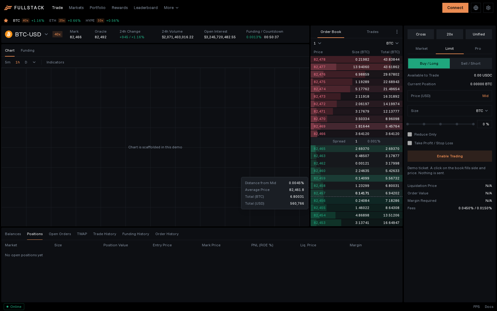
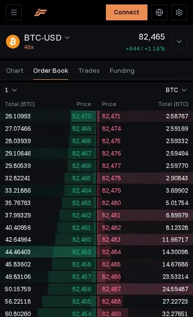

# fullstack-fe

A Fullstack trade page built around a live order book on Hyperliquid's feed, made for Fullstack's frontend take-home.

**Live:** https://fullstack-fe-five.vercel.app





## The brief, point by point

| Asked for | Where it is |
|---|---|
| BTC and ETH from a dropdown | The pair name opens a searchable picker over every Hyperliquid perp. BTC and ETH are pinned as favorites under the nav. |
| A dropdown for `nSigFigs` | The precision control above the book, labeled in tick sizes for the current price |
| A shareable live demo | The link above. `/trade/SOL` and friends link to a market. |
| React or Next with no excessive re-renders | Next 16. The perf suite fails if a level change re-renders more than its own rows. |
| The example's colors and theme | Fullstack's palette and font from fullstack.trade, on Hyperliquid's layout, which the brief names as the bar |

## What's real and what's scaffolded

Real: the order book and tape, the market bar (mark, oracle, 24h change, volume, open interest, funding and its countdown), market search with favorites, and the order ticket's side and price, which a click on the book fills.

Scaffolded so the page reads as a whole: nav, chart, order types, leverage and margin, and the account tabs. Their controls are disabled, and nothing places orders.

## Reading the book

- Bars are cumulative depth. The darker segment inside each is the size at that level alone, so walls stand out.
- With a mouse, hovering a level shows a card pricing a market order that sweeps to it: distance from mid, average price, and totals in the coin and in USD. On touch, a tap shows the same in a strip.
- Flashes scale with the size change. A top-up barely blinks; a wall landing or getting pulled lights the row.
- The tape colors prints by aggressor and merges one taker's fills in a block into one line. Prints with a transaction hash link to the Hyperliquid explorer.
- The ⋮ menu has Hyperliquid's panel modes (Tab, Stacked, Large) and four book layouts. Phones get Hyperliquid's mobile view with bids and asks side by side.
- Search opens from the pair name or ⌘K: type to filter, ↑↓ to move, Enter to switch, ⌘S to star, Esc to close. Strict hides delisted markets.

## How it works

```text
api.hyperliquid.xyz/info   metaAndAssetCtxs -> the market list, its decimals, leverage and stats
api.hyperliquid.xyz/ws     one socket per tab, shared by every widget
  l2Book fast (~540 ms) + bbo (~140-190 ms) + 20-level depth polled every 500 ms + trades + activeAssetCtx
    -> paced(): at most one publish per animation frame and per 50 ms
    -> pure reducers: merge book sources by recency, cumulative totals, flash marks; dedupe and merge fills
    -> TanStack Query streams, structural sharing
    -> each row subscribes to its own level
```

- The default `l2Book` subscription pushes every ~5.4 s, so the book layers faster sources and the newest source owns the prices it covers.
- Book messages don't say which `nSigFigs` they're for, and a stale snapshot beat the new ack in 7 of 24 measured swaps, so pushes are dropped until the ack. A bad subscription kills the socket, so nothing subscribes until the coin is in the market list.
- The spread reads `bbo`, which is never grouped. Fills merge by side, price, block and taker. A reconnect's 30-trade replay dedupes by trade id, as a set, because ids aren't ordered.
- Stream queries restart on every mount. Cached stream data otherwise counted as fresh forever and a remount froze the book.
- The widget pauses offscreen, in a hidden tab, and while search is open. Loading states are skeletons at their final size.
- Bars snap, like every venue's. Changes flash an overlay on the compositor, cancelled before the next. Hovering draws one measured overlay; a per-row `:has()` selector tripled message-to-DOM latency.

## As a widget

```tsx
<OrderBook market="ETH" defaultMode="large" defaultLayout="split" onPriceSelect={({ coin, side, price }) => {}} />
```

`market` and `view` (`book` or `trades`) follow the parent. `defaultMode` and `defaultLayout` set the starting state, which the ⋮ menu changes. It fills its container, fits rows to the height, and pauses when offscreen, in a hidden tab, or `paused`. `/embed/BTC` renders one widget full page. Known limit: two widgets on one coin at different precisions can't both get the fast book, because book messages don't carry `nSigFigs`.

## Performance

`pnpm test` builds with React's Profiler on, then runs every test on a Pixel 7 profile and on desktop Chrome against a scripted Hyperliquid socket. The perf tests fail on regression:

| Claim | Gate | Measured |
|---|---|---|
| 60 fps under a 1,000 msg/s burst, widget and trade page | best of 3 trials over 55 fps, p95 frame under 20 ms | 60 fps, p95 frame 16.7 to 16.8 ms; the trade page held it in all 6 trials |
| At most one book commit per frame, 20 a second | every trial | about 15 commits a second |
| One level change re-renders its row and the deeper ones only | exactly one commit, exactly those rows | as gated |
| Message to DOM | p95 under 25 ms | p95 17.9 to 19.0 ms |
| Usable at 4x CPU | over 6 fps, longest frame under 250 ms | 8 to 10 fps, longest frame 149 to 153 ms |
| Precision switch | median slowest input under 100 ms | 32 ms |
| Heap over a 15 s stream | growth under 1 MB | +354 to +891 KB |

Measured on headless Chromium in a shared VM with no GPU, which paints on the CPU. By hand at a steady 20 msg/s, the trade page keeps the main thread 38% busy on desktop and 2.5% with search open. Most of it is layout: a change at the top of the book moves the total on every deeper row.

Skipped on purpose: canvas (DOM rows hold 60 fps and stay accessible), a worker (the cost is React, style and layout, which can't move), virtualization (40 rows at most), and an animation library.

## Run

```sh
pnpm install
pnpm dev
pnpm exec playwright install chromium
pnpm test
```
